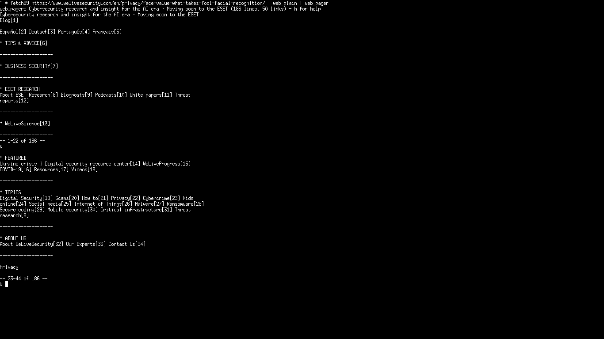

# web 2.0



A small terminal HTML reader in C89, split into two programs:

- `web_plain` reads HTML on stdin and writes wrapped plain text plus a `References:` list on stdout.
- `web_pager` reads that text on stdin and shows it in a mailx-style pager.

No networking: pages are fetched by `wget`/`curl` and piped in.

> **Note:** version 1.0 was a single `web` program (converter and pager in one).
> It is still available here: https://github.com/KrzysztofMarciniak/web/releases/tag/1.0
> 2.0 replaces `web` with `web_plain | web_pager`.

##### No curl/wget?
[fetch89](https://github.com/KrzysztofMarciniak/fetch89) - Fetch a URL over HTTP or HTTPS and print the body. One C89 file.

## Build

```sh
make
sudo make install            # PREFIX=/usr/local by default
make clean
```

Optional: `make CPPFLAGS=-DNO_TIME` drops `<time.h>`. Archive files are then named `web-title-slug.html` (no timestamp, `-1`, `-2`, ... on collisions) and the pager's `e` temp file uses a counter instead of the clock.

`web_plain` and `web_pager` must be on `$PATH` for `g N` to work.

## Usage

```sh
wget -qO- 'http://example.com' | web_plain | web_pager     # interactive
curl -fsSL 'http://example.com' | web_plain | less         # plain text
curl -fsSL 'http://example.com' | web_plain > page.txt
wget -qO- 'http://example.com' | web_plain --archive       # save raw HTML
fetch89 example.org | web_plain | web_pager
```

`web_pager` takes its commands from `/dev/tty`. Without a tty it copies its input to stdout.

### web_plain options

| Option | Meaning |
|---|---|
| `-a`, `--archive` | Save the raw HTML to a file, print its path, write no text. |
| `--base URL` | Base URL for resolving relative links. Used by `g N` in the pager. |
| `-v`, `--version` | Print version. |

### web_pager options

| Option | Meaning |
|---|---|
| `-v`, `--version` | Print version. |

### Pager commands

Prompt is `& `.

| Command | Action |
|---|---|
| `Enter`, `n`, `+` | Next page |
| `p`, `-` | Previous page |
| `t` | Top |
| `a` | Print everything |
| `/text` | Search (case-insensitive, starts after current page, wraps). `/` alone repeats the last search. |
| `l` | List all links |
| `N` | Show URL of link N |
| `g N` | Follow link N: runs `$WEB_FETCH 'URL' \| $WEB_PLAIN --base 'URL' \| web_pager` |
| `e`, `v` | Open the text in your editor |
| `w file` | Write text and references to `file` |
| `h`, `?` | Help |
| `q`, `x` | Quit |

The 1.0 `s` (archive) command is gone: the pager never sees the raw HTML. Use `web_plain --archive`.

## Text format

`web_plain` output is the contract between the two programs:

- Body text, wrapped to the text width.
- If the page has links: an empty line, then `References:`, then one line per link, formatted as `%3d. URL`.

`web_pager` takes the last `References:` block at the end of its input, if every line after it looks like a numbered URL, and uses it as the link list. Any other text works as input too (no links then).

## Environment

| Variable | Used by | Default | Purpose |
|---|---|---|---|
| `WEB_WIDTH` | web_plain | `min(COLUMNS, 80)` | Text width (minimum 20). |
| `COLUMNS` | web_plain | 80 | Terminal width. |
| `WEB_ARCHIVE_DIR` | web_plain | current directory | Where archives go. Must already exist. |
| `LINES` | web_pager | 24 | Terminal height. |
| `WEB_FETCH` | web_pager | `wget -qO-` | Command used by `g N` to fetch a link. |
| `WEB_PLAIN` | web_pager | `web_plain` | Converter used by `g N`. |
| `EDITOR` | web_pager | `VISUAL`, then `vi` | Editor for `e`. |
| `TMPDIR` | web_pager | `/tmp` | Temp file location for `e`. |

Shells often do not export `COLUMNS`/`LINES`: `export COLUMNS LINES` if width or page height is wrong.

Archive files are named `YYYYMMDD-HHMMSS-title-slug.html`, with `-1`, `-2`, ... added if the name exists.

## Requirements

Build:
- A C89 compiler and `make`. Only ISO C headers are used: `stdio.h`, `stdlib.h`, `string.h`, and `time.h` (not needed with `-DNO_TIME`). No POSIX headers.

Run:
- A POSIX-style shell for `system()` in the pager (`g N`, `e`).
- `/dev/tty` for the interactive pager.
- `wget` (or whatever `WEB_FETCH` points to, e.g. `curl -fsSL`) only for following links.

## How it works

`web_plain.c`, in this order:

1. **Buffers and helpers.** Growable `Buf`, allocation wrappers, ASCII tests, case-insensitive search.
2. **Entities.** Named entities (common ones) and numeric `&#N;` / `&#xN;` to UTF-8.
3. **Output building.** `emit`, `brk`, `text` collapse whitespace, track blank lines, pass `<pre>` through.
4. **URLs.** `resolve` makes relative links absolute using `--base`, `<base href>` or `<link rel=canonical>`; `dedot` removes `.` and `..`.
5. **HTML parsing.** `tag` handles each tag, `parse` walks the input in a single pass. No DOM.
6. **Dedupe.** Post-pass over the text.
7. **Wrapping.** Breaks lines at spaces, counting UTF-8 characters (not display width).
8. **Output.** Text, `References:`, or `--archive`.

`web_pager.c`: reads stdin, splits off the `References:` list, splits the rest into lines, and runs the pager loop on `/dev/tty`.

### What the parser does

- Headings become `#`..`######` lines, list items `* item`, `<hr>` a dashed line, table cells are joined with ` | `.
- Links get numbered `[N]` markers; URLs are listed under `References:`. The same URL always gets the same number. `#...` and `javascript:` links are ignored.
- Images with a useful alt text become `[img: alt]`. If an image is inside a link, the alt is only shown when the link has no other text. Alt texts that look like file paths are ignored.
- Skipped entirely: `script`, `style`, `noscript`, `svg`, `template`, `button`, `select`, `textarea`, `iframe`, `canvas`, `object`.
- Hidden elements are skipped with their content: `hidden`, `aria-hidden="true"`, inline `display:none` / `visibility:hidden`, and Bootstrap `d-none` / `d-lg-none` (unless a responsive `d-*-inline` etc. class re-shows it).
- A line identical to the previous non-blank line is dropped. `[img: X]` counts as equal to `X`. Lines inside `<pre>` are never touched. Empty `*` list items are removed.

## Limits

- No JavaScript, CSS layout, forms, frames or images. Only the inline hiding rules above are understood.
- Input is assumed to be UTF-8. No charset conversion.
- The whole page is read into memory.
- Deduplication only compares consecutive lines, so text repeated far apart stays.
- If two different links have identical consecutive text, the second line is dropped along with its link number.
- The pager shows the page title from the first non-blank line of the text, not from `<title>`.
- The temp file for `e` has a predictable name in `$TMPDIR`; do not use `e` on a shared multi-user `/tmp` if that matters to you.
